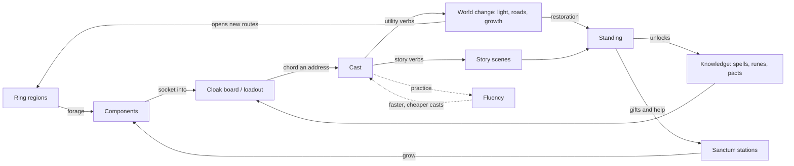

# Loop Stack

The game's loops at four time scales. Each loop below has its own note in `Concepts/Loops/`. This is the proposed answer to **Q-16** (what is the core loop?).

## 1. Moment (2-10 s): chord → cast → the land answers
Shape a row, commit, shape a column, commit; the spell lands and the world visibly changes. Practised in the [[Light-Up Drill]], reused as [[Chord QTEs]].

## 2. Encounter (1-5 min): read → prepare → resolve
A blight front, a broken bridge, a wary spirit, a sealed door. Read it (often by [[Astral Projection]] or [[Familiar Vision]]), pick the right verbs, resolve it, and leave the place changed. See [[Encounter Types]].

## 3. Session (30-60 min): the expedition
Leave the Hollow with a packed cloak, cross a region, forage, meet people, solve encounters, return with components, stories and Standing.
- [[Expedition Loop]] (the spine of a session)
- [[Astral Scouting Loop]] (a phase inside an expedition)
- [[Story Scene Loop]], [[Commission Loop]] (authored content along the way)
- [[Research Loop]] (discover and inscribe new spells)

## 4. Long term (weeks): the land and your place in it
- [[Sanctum Loop]]: build and upgrade stations in the Hollow that grow components.
- [[Restoration Loop]]: heal regions; restored land opens roads, people and story.
- School storyline: your order's arc ([[Story and RPG MOC]]).
- [[Seasonal Contest Loop]], [[Ritual Raid Loop]]: co-op and community peaks.
- [[Duel Loop]], [[Subterfuge Loop]]: rare, consensual player conflict.

## Proposed answer to Q-16
- **Onboarding:** the Light-Up Drill as apprentice lessons (Loop Candidate 1).
- **Spine:** Expedition (session) feeding the Sanctum (long term).
- **Content:** Story Scenes and Commissions along expeditions.
- **Visible arc:** Restoration of the Ring.
- **Social peak:** Ritual Raids with friends.

## Systems map

## Related
- [[Design Pillars]], [[Gameplay Loop Candidates]], [[Loops MOC]]
